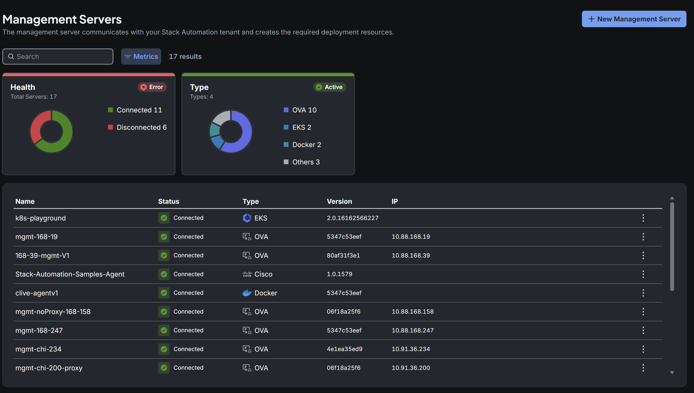
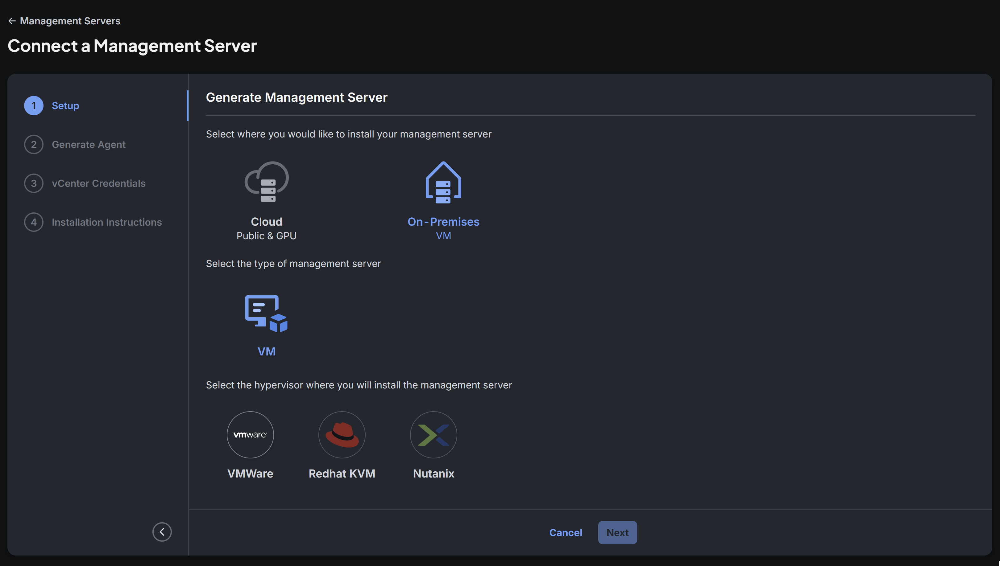
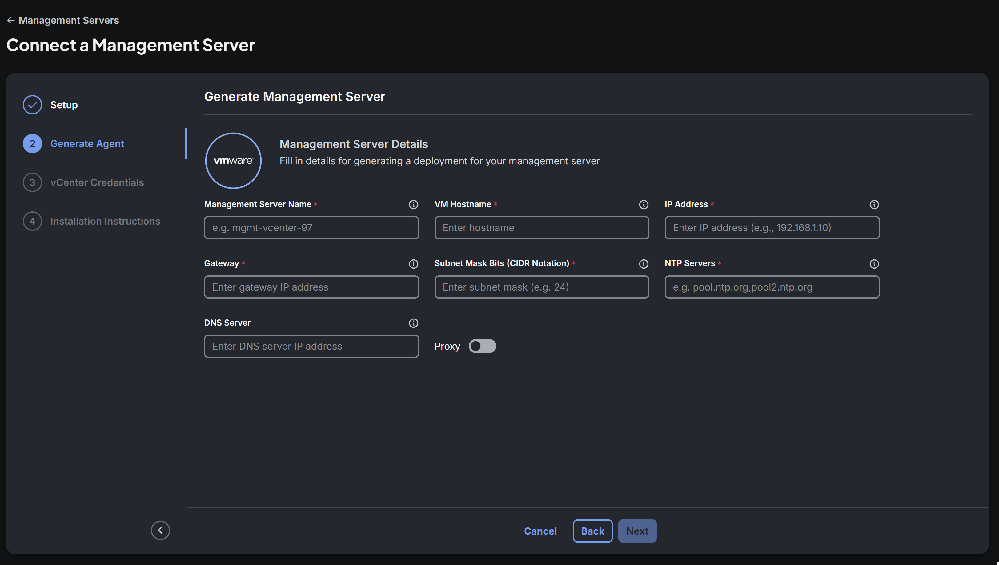

# Install the Stack Automation Management Server

A **management server** (also referred to as an *agent*) is the component that communicates with your Stack Automation tenant and creates the required deployment resources. It executes, manages, and monitors the workloads that Stack Automation deploys on your behalf.

This quick-start guide walks you through the fastest path to get Stack Automation up and running: connecting a single management server. Unlike blueprint-driven onboarding, a management server does **not** require a space or a repository — you can install it on its own and associate it with spaces and repositories later.

In this guide we will cover:

- Where a management server can be installed (cloud or on-premises)
- Generating the deployment for your management server
- Installing the management server and verifying that it is connected
- (Optional) Associating the management server with a space and launching blueprints from a repository

:::info What is a management server?
The management server is a lightweight orchestration component deployed in your own environment. Once connected, it appears in **Resources → Management Servers**, where you can monitor its **health** (Connected / Disconnected), **type**, **version**, and **IP**. Stack Automation supports several management-server types, including virtual machine images (**OVA**), managed Kubernetes (for example **EKS**), **Docker**, and self-managed Kubernetes.
:::

---

## Step #1: Open the Management Servers page

1. Navigate to **Resources → Management Servers**.
2. Review the list of existing management servers. The page shows an at-a-glance **Health** and **Type** breakdown, plus a table with each server's **Name**, **Status**, **Type**, **Version**, and **IP**.
3. Click **New Management Server** in the top-right corner to open the **Connect a Management Server** wizard.

---

## Step #2: Choose where to install (Setup)

In the **Setup** step, select where you would like to install your management server:

| Option | Description |
| --- | --- |
| **Cloud** | Install into a public or GPU cloud. After choosing this option, select **Public Cloud** or **GPU Cloud**. |
| **On-Premises** | Install as a virtual machine (**VM**) in your own datacenter. After choosing this option, select the **VM** type and then the hypervisor: **VMWare**, **Redhat KVM**, or **Nutanix**. |

Make your selection and click **Next**.

:::note
The remaining steps depend on your choice. Installing on **VMware** adds an optional **Add Credentials** step for your vCenter (covered below). Cloud installations skip that step and go straight to the installation instructions.
:::

This guide follows the **On-Premises → VM → VMWare** path as an example.

---

## Step #3: Generate the management server (Generate Management Server)

In the **Generate Management Server** step, fill in the details Stack Automation needs to build a deployment for your management server.

| Field | Required | Description | Example |
| :--- | :--- | :--- | :--- |
| **Management Server Name** | Yes | A unique, human-readable name for the management server. | `mgmt-vcenter-97` |
| **VM Hostname** | Yes | The hostname to assign to the deployed virtual machine. | `mgmt-vcenter-97` |
| **IP Address** | Yes | The static IP address the management server will use. | `192.168.1.10` |
| **Gateway** | Yes | The default gateway IP address for the VM's network. | `192.168.1.1` |
| **Subnet Mask Bits (CIDR Notation)** | Yes | The subnet mask expressed as CIDR bits. | `24` |
| **NTP Servers** | Yes | One or more NTP servers (comma-separated) used to keep the VM's clock in sync. | `pool.ntp.org,pool2.ntp.org` |
| **DNS Server** | No | The DNS server IP address the VM should use for name resolution. | `192.168.1.53` |
| **Location** | No | The geographic location of the management server, selected from the city search. | `Austin, United States` |
| **Proxy** | No | Toggle on to route the management server's outbound traffic through an HTTP/HTTPS proxy, then provide the proxy details. | — |
| **VPC** | No | Toggle on to provide the VPC settings for the appliance. Hover over the ⓘ icon for details. | — |

When all required fields are complete, click **Next**.

:::tip
Hover over the ⓘ icon next to any field for inline guidance. Use a static IP that is reserved for the management server so its address does not change after deployment.
:::

---

## Step #4: Add vCenter credentials (VMware only, optional)

For the VMware path, the wizard adds an **Add vCenter Credentials (Optional)** step (shown as **Add Credentials** in the step list). It lets you store the vCenter credentials that Stack Automation will later use when this vCenter is added as a target [Provider](/getting-started/Resources-Inventory/adding-a-provider).

This step is optional: you can skip it now and add the target credentials later from **Resources → Inventory**. Adding them now can save time if the management server is deployed in a network with access to your internal vCenter, because you complete the setup in one flow instead of returning later to create the same credentials.

:::note
Credential connectivity can be tested only after the management server is deployed and connected to Stack Automation. Choose an account scoped to the target datacenter or cluster rather than a full administrator account where possible.
:::

Enter the credentials (or leave the step empty) and click **Next**.

---

## Step #5: Install the management server (Installation Instructions)

The final **Installation Instructions** step prepares the management server appliance for your chosen target:

1. **SSH private key** - Stack Automation generates an SSH key for authenticating to the appliance. Copy and save it now; it is not accessible after you close the wizard.
2. **Download Management Server File** - Stack Automation builds the management server OVA file (this takes approximately two minutes). Click **Download** to save it. **Finish** stays disabled until the OVA file has been downloaded.
3. Follow the on-screen **Instructions** to deploy the appliance:
   1. Go to your ESX server.
   2. Click **Create or Register a VM** and follow the steps.
   3. Select the downloaded `.ova` file and make sure the network adapter that allows external connectivity is selected before you click **Finish**.

For **cloud** targets, this step instead shows a command (for example a `kubectl`-based command for Kubernetes) that you run against your cluster, followed by a **Connections Status** panel.

:::info
It may take up to a couple of minutes for a freshly deployed management server to start up and register. Wait for the **Connected** indication before continuing.
:::

### Verify the connection

Return to **Resources → Management Servers**. Your new server should appear in the list with a green **Connected** status. If it still shows **Disconnected** after a few minutes, confirm that the VM is powered on and that it has outbound network access (and correct proxy settings, if configured) to reach your Stack Automation tenant.

🎉 That's it — your management server is connected and ready to deploy blueprints from the Solution Hub.

---

## What's next (optional)

A connected management server is fully functional on its own, but to start deploying from blueprints you'll typically pair it with a space and a repository.

### Associate the management server with a space

Spaces are logically separate areas that group management servers, repositories, and permitted users. To let a space deploy through your new management server:

1. From the management server's actions menu (or the post-connection dialog), choose **Associate to space**.
2. Select the target space.
3. Set the **default namespace** and **service account** that Stack Automation will use to deploy workloads through this server. These defaults can be changed later in **Resources → Management Servers**.

### Launch blueprints from a repository

Once a management server is associated with a space, you can connect a repository to that space, discover its automation assets, and generate blueprints from them. Publishing a blueprint to the space catalog lets end-users launch deployments — Stack Automation will execute those deployments through the associated management server.

For the full workflow, see the guides on creating a space, connecting a repository, and launching a deployment.
